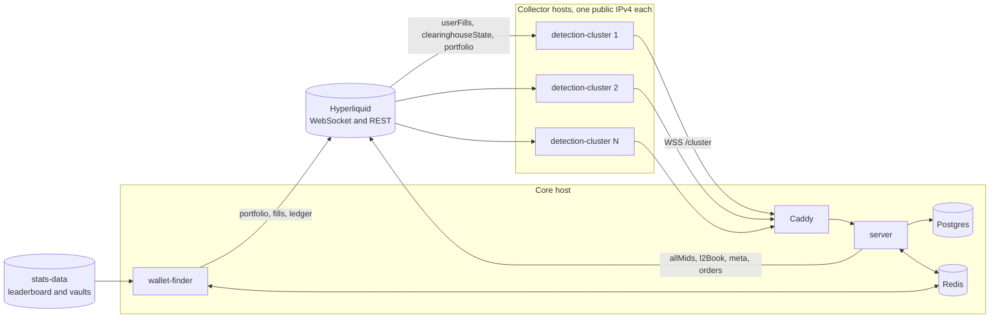

# remora

remora is a copy-trading system for Hyperliquid perpetuals.
It scores the large wallets of the public leaderboard every day, watches the best of them in real time, and copies their trades in paper mode or live.
This README is the whole write-up of the project, from the design to the measurements and the verdict.

## Architecture



| Package | What it is |
|---|---|
| `detection-cluster/` | the collector, one per public IP, which streams the fills, positions and equity of at most 8 wallets to the core |
| `server/` | the core: the cluster link, ingestion, signals, the decision engine, paper and live execution, reconciliation, jobs, the API and the replay |
| `wallet-finder/` | the daily discovery and scoring worker, which talks to the server only through BullMQ |
| `dashboard/` | a Vite and React app for leaders, decisions, copies and collectors, fed by the API and a server-sent event stream |
| `sdk/` | the Hyperliquid types, the info client, the socket, the weight budget and the cluster protocol shared by every service |
| `hyperliquid-sim/` | a stand-in for the part of the Hyperliquid API the system uses, which enforces the per-IP limits and knows the true answer to every fill |
| `scale-lab/` | system tests that run the real images against the simulator at scale and through failures |
| `infra/` | Terraform for production on Vultr and staging on Incus, Ansible roles, Caddy, Prometheus and Grafana |

Hyperliquid limits each IP to 10 users across user-specific subscriptions, 10 sockets and 1,200 REST weight a minute.
The collectors are the only part those limits force onto separate machines.
Each collector runs on its own public IPv4 and holds at most 8 wallets, which leaves headroom under the user limit.
Everything else runs on one core host.
wallet-finder is a separate process, so parsing the large leaderboard file and scoring its wallets never blocks the event loop of the copy path.
The split also gives discovery its own slice of the core's REST budget.

## The path of one copied trade

1. A tracked leader's order fills, and Hyperliquid pushes the fills to the collector that holds the wallet, over one multiplexed `userFills` subscription.
2. The collector forwards the raw frame to the core over its authenticated WebSocket link, together with the time it received it.
3. The core stores each main-dex perp fill once under `(wallet, coin, tid)` and turns the new fills of each coin into a signal, with the leader's position before and after taken from `startPosition`.
4. The signal enters the promise chain of its book, the main book for LIVE leaders and a ledger of its own per SHADOW leader, so no two actions ever touch one copy at once.
5. The decision engine, a pure function that paper, live and replay share, runs 11 policies in a fixed order: instrument, leader mode, episode, exit path, kill switch, signal age, price drift, coin lock, leader equity, sizing and margin.
6. The decision is stored with its 11-line trace before anything is sent.
7. An entry is an IOC limit at the leader's VWAP banded by the drift limit.
   An exit is an IOC limit 3% through the mid, sized against the leader's position with the copy's ratio frozen at open.
8. The paper executor waits 900 ms by default to stand in for the order round trip from Tokyo, then walks the live `l2Book`.
   The live executor signs the order with a client order id and a 5 s expiry, and resolves an unknown result by that id once the expiry has passed.
9. The copy position, its fees and its stop are updated, and the dashboard and Telegram hear about it from one in-process event stream.

Each wallet has a watermark, the time up to which every fill is stored.
After any reconnect the collector backfills from the watermark over REST.
The core holds the wallet's signals until the backfill reports `synced`, then decides the held fills as one catch-up per coin.
The REST history can trail the live stream by seconds.
A backfill reports `synced` only once REST has caught up with the newest fill the collector held back, which closes the gap between them.
A fill that was stored but never decided, because the core crashed in between, joins the wallet's next catch-up.

## Running it locally

You need Node 24.15 or later with corepack, which fetches the pinned pnpm, and Docker with Compose v2.

```sh
corepack enable
pnpm install
pnpm -r run build
```

### The whole system against the simulator

This needs no Hyperliquid access and no internet once the images are built.

```sh
SIM_SPEED=30 docker compose -f docker-compose.yml -f docker-compose.sim.yml --profile app up --build -d
```

Open the dashboard at http://127.0.0.1:8080, or on `DASHBOARD_PORT` when 8080 is taken, and press "Run now" on the overview page.
wallet-finder scores the simulator's 300 synthetic wallets, and selection moves 6 of them into the shadow book.
The collector subscribes them, and paper copies open, resize and close as they trade.
`SIM_SPEED` makes the synthetic wallets trade that many times more often, so copies show up every few minutes.

`docker compose -f docker-compose.yml -f docker-compose.sim.yml -f docker-compose.failover.yml --profile app up -d` adds a second collector and sets both to 4 wallets.
Stopping the first one moves its wallets to the second after a 30 s grace period.
`docker compose --profile monitoring up -d` adds Prometheus on http://127.0.0.1:9090 and Grafana on http://127.0.0.1:3001 with a provisioned dashboard.

### The whole system against Hyperliquid

```sh
docker compose --profile app up --build -d
```

This runs one copy of every service with one collector of 8 wallets, which is all one home IP can hold.
The local REST budgets are 300 a minute for the collector, 300 for the server and 500 for wallet-finder.
Anything else on the same IP spends from the same limits.
`STAGE_ONE_LIMIT` defaults to 200 locally to shorten a discovery run.
An empty value runs the full stage one, which takes much longer at the production budget of 600.
The root `.env.example` lists the overrides, such as the host ports of Postgres and Redis when 5432 and 6379 are taken.

### Services on the host

```sh
docker compose up -d
cp server/.env.example server/.env
cp detection-cluster/.env.example detection-cluster/.env
pnpm --filter server prisma:migrateDeploy
pnpm --filter server start:dev
pnpm --filter detection-cluster start:dev
REDIS_URL=redis://127.0.0.1:6379 HYPERLIQUID_WEIGHT_PER_MINUTE=500 pnpm --filter wallet-finder start:dev
pnpm --filter dashboard dev
```

The example files pair the collector's dev token with the hash the server accepts.
Their REST budgets of 300 for the collector and 300 for the server, with 500 for wallet-finder, keep the home IP under its 1,200 a minute.
Add a wallet by hand with `curl -X POST 127.0.0.1:3000/api/leaders -H 'content-type: application/json' -d '{"address":"0x..."}'`, and it enters the shadow book at once.
Vite serves the dashboard on http://127.0.0.1:5173 and proxies `/api` to the server.

### Tests

```sh
pnpm -r run lint
pnpm -r run typecheck
pnpm -r run test
pnpm -r run test:integration
```

The integration specs start their own Postgres and Redis through Testcontainers, so they need Docker.
`pnpm --filter scale-lab lab` builds the images from the compose files, then runs every scale-lab scenario.
`pnpm --filter scale-lab lab:baseline` runs the baseline scenario alone.

### Replay

```sh
pnpm --filter server replay --wallet 0x... --days 30
```

The replay reads a leader's last 30 days of fills, candles and funding and runs them through the same decision engine.
It writes `reports/replay-<wallet>-<date>.md` and `.json` under the directory it runs in, with every number labelled as a replay of its window.
It reads the server's configuration, so it runs with `server/.env` in place.
It calls the info endpoint that `HYPERLIQUID_API_URL` names, which can be the simulator.

## Deploying

Production is one core and one collector per public IPv4 on Vultr in Tokyo, the closest region to Hyperliquid's API.

1. Copy `infra/terraform/production/terraform.tfvars.example` to `terraform.tfvars`, set the admin CIDRs, the SSH key you connect with, the domain, the ACME contact address and the `collectors` map, and export `VULTR_API_KEY`.
   The domain must already be a zone in Vultr DNS.
2. `make infra-apply` creates the hosts, the firewall groups and the DNS record, and `make inventory` writes the Ansible inventory.
   Terraform refuses any plan that would destroy or replace the core, because Postgres lives on its disk.
3. Back up `infra/terraform/production/terraform.tfstate` after every apply, because the state is local and gitignored.
4. Create `infra/ansible/group_vars/production/`, copy `infra/ansible/group_vars/all/vault.example.yml` into it as `vault.yml`, and fill in every value.
   Create `~/.config/remora/` and write a vault password to `vault-password-production` in it with mode 600, which is where `make` reads it.
   Then encrypt the copy with `ansible-vault encrypt --vault-id production@$HOME/.config/remora/vault-password-production infra/ansible/group_vars/production/vault.yml`.
   Staging keeps its own vault in `group_vars/staging/` under `vault-password-staging`, so the home server never holds a production secret.
5. Install the collections with `ansible-galaxy collection install -r infra/ansible/requirements.yml`, then run `make site` to prepare every host.
   It waits for cloud-init, keeps only the SSH key from `terraform.tfvars`, hardens SSH and the firewall, and installs Docker.
6. Push to `main` and let CI build and push the images to GHCR.
   Then run `make deploy TAG=<full commit SHA>`, which deploys the core first and the collectors one at a time behind a health gate.
   The core's deploy ends only once `https://core.<domain>` answers the laptop with a valid certificate.

Adding a collector means adding its token to the vault and its entry to the `collectors` map, then running `make infra-apply`, `make inventory`, `make site`, `make deploy-core` and `make deploy-collectors`, with `TAG` set to the release that runs now.
`make deploy-core` gives the core the new token, and `make deploy-collectors` first rewrites the core's Caddyfile from the inventory, so the core lets in a collector whose address is new.

Staging uses the same playbooks on Incus system containers on a home server, with the simulator on the core and Caddy's internal certificate authority.
After `incus admin init` and trusting the laptop, copy `infra/terraform/staging/terraform.tfvars.example` to `terraform.tfvars` and fill in `group_vars/staging/vault.yml` the same way.
Then `make infra-apply ENV=staging`, `make inventory ENV=staging`, `make site ENV=staging` and `make deploy ENV=staging TAG=<full commit SHA>` bring it up.
`make lab-home` runs the scale lab on the home server through `DOCKER_HOST`.

## Live trading

Paper mode is the default for both books, and the shadow book is always paper.
The main book trades live only with `EXECUTION_MODE=live`, after the boot checks pass.

1. Use a dedicated master account in standard abstraction.
   Unified and portfolio-margin accounts report equity that the kill switch cannot read, and the server refuses to start live against them.
2. Generate a fresh key for an API wallet, and approve it from the master account in the Hyperliquid app with a name of up to 16 characters and a `valid_until` at most 180 days ahead.
3. Put the API wallet's private key into the vault as `vault_hyperliquid_agent_key`, set `core_execution_mode: live` and `core_hyperliquid_account_address`, and redeploy the core.
4. Run the testnet smoke first, with a testnet account and agent: `HYPERLIQUID_NETWORK=testnet HYPERLIQUID_ACCOUNT_ADDRESS=0x... HYPERLIQUID_AGENT_KEY_FILE=./agent.key pnpm --filter server testnet:smoke`.
   It checks the boot checks, signing, client order ids, expiry, exact closes and the stop lifecycle.
   It writes its answers to `reports/testnet-smoke-<date>.json` under the directory it runs in.

The API wallet can trade the account but cannot withdraw or transfer.
The master key never reaches a server.
To rotate it before its `valid_until`, approve a new API wallet with a new key and a new name, replace the vault entry, redeploy the core, and remove the old one in the app.
Never approve an address again after it was removed, because its pruned nonces would let old signed actions replay.
The live account must not receive transfers while it runs, because a transfer would read as profit or loss to the kill switch.
In live mode a SHADOW leader becomes LIVE only through the dashboard's promote action, so real money never follows a leader nobody approved.

## Limits and risks

A self-run non-validating Hyperliquid node removes every per-IP limit and is the sanctioned path for watching many wallets.
The price is a machine with 16 vCPU, 128 GB of RAM and 500 GB of SSD.
remora takes the documented API path instead, which fits a few dozen tracked wallets on small collector VMs.

Hyperliquid's terms of use forbid bots that get around rate limits on its interface, and forbid hiding a location behind VPNs or proxies.
Whether several collectors on several IPs count as getting around the limits of the public API is not settled.
Each collector is a plain client with its own fixed IP that never rotates or proxies.
The system works with a single collector, and whether to run more than one is a decision for whoever deploys it.
The terms also close the interface to persons in some jurisdictions, including the United States, so live trading stays off unless the operator is eligible.

None of this is a claim that copying these leaders makes money.

## Measured

Every number in this section comes from a report in [`reports/`](./reports/) and carries the label of how it was produced.

- **simulated**: the scale lab ran the real images against `hyperliquid-sim` on one Docker host, so the leaders, the market and the per-IP limits were the simulator's.
- **replay**: a leader's historical fills ran through the decision engine with a modelled latency of 1,200 ms, a mid drift of 2 bps against the copy and a sweep cost of 1.4 bps per fill.
- **paper, simulated market**: the compose stack ran in paper mode against `hyperliquid-sim`, so the paper fills walked synthetic books.

The runs took place on 2026-10-05 and 2026-10-06 UTC, after the code they measure was written.
The scale-lab reports ran on the final code.
The paper run and the replays ran on 2026-10-05, before two late fixes to rare recovery paths and before paper book reads got a budget of their own.
Nothing here comes from a paper run against the real Hyperliquid API, from live trading or from testnet, because none of those has been run yet.

### Scale and failure, simulated, 2026-10-06

Every scenario checks four invariants against the simulator's ground truth: no fill of a tracked wallet missing from Postgres, no decision chain broken or doubled, no open copy away from k times its leader without a recorded reason, and no limit refusal the scenario did not provoke.

| Scenario | Setup | Result |
|---|---|---|
| baseline | 3 collectors, 24 wallets, simulator speed 10, 10 minutes | all four invariants held, 216 simulator fills compared with 0 missing, 138 decisions in 20 chains with 0 breaks |
| collector loss | 6 collectors and 24 wallets, 2 collectors killed | the 8 orphaned wallets were subscribed again 30.6 s after the kill and synced 39.7 s after it, 0 of 350 fills missing |
| core restart | 4 collectors and 32 wallets, the server stopped with SIGTERM and later killed with SIGKILL | the server answered again after 2.7 s and 2.8 s, every wallet synced 23.8 s and 24.9 s after the stops, 10 catch-up decisions, 0 of 610 fills missing, 0 chain breaks |
| upstream storm | 4 collectors and 32 wallets, every socket dropped 5 times 12 s apart | at most 4 new connections a minute from the busiest address against a limit of 30, every wallet synced 28.3 s after the last drop, 0 of 450 fills missing |
| database outage | 4 collectors and 24 wallets, Postgres stopped for 32 s | 4 sessions closed with 4005, every wallet synced 39.2 s after Postgres returned, 0 of 330 fills missing |
| user limit | two collectors of 6 wallets on one source address, a third of 8 started later | the simulator refused 4 users, both collectors dropped to 5 wallets, and the 2 waiting wallets moved to the third collector |
| discovery | a full run over 300 synthetic wallets with a tracked target of 16 | 15 of the 16 selected wallets carry a planted edge, against 11 of the top 16 by all-time PnL, 7 of the top 16 by 30-day PnL and 44 of all 262 leaderboard rows that are not vaults |
| scale | 12 collectors, 96 wallets, simulator speed 100, 10 minutes | all four invariants held, 10,471 simulator fills compared with 0 missing, 5,245 decisions in 170 chains with 0 breaks, a server event-loop lag p99 of at most 13.8 ms |

Latency of stream signals in the baseline, from the timestamps stored in Postgres:

| Step | p50 ms | p90 ms | p99 ms |
|---|---|---|---|
| leader fill to collector receive, the simulator's own 200 ms push tick | 116 | 185.2 | 198 |
| collector receive to core store | 3 | 9 | 71.6 |
| collector receive to decision | 16 | 32.4 | 496.4 |
| decision to order submit | 5 | 12.2 | 33.8 |
| order submit to acknowledgement, the configured 900 ms paper latency | 906 | 912.2 | 921.8 |
| leader fill to acknowledgement | 1,043 | 1,128.2 | 1,544.4 |

The server's event-loop lag stayed at a p99 of 10.6 ms at the median and 12.4 ms at worst.

The scale scenario compresses a hundred times the normal trading into real time, while every REST budget stays real time.
Paper fills of both books may spend 120 of the server's 400 weight a minute.
At this speed they asked for more, so the server spent its 120 every minute and paper acknowledgements waited 45.6 s at the median.
Each leader's decisions queued behind its own paper orders, and 1,522 of the 5,245 decisions came too late to enter and were skipped as `stale_signal`.
No fill went missing and no decision chain broke meanwhile.
The server's event loop stayed at a p99 of 11.7 ms at the median.
At real speed the same leaders trade a hundred times less often, so this ceiling belongs to the compressed test.
The separate paper budget keeps it away from live orders.

### Replays of 30 days, replay, 2026-09-05 to 2026-10-05

Each replay copied one leader with 5,000 USD through the same engine, with 15-minute candles for marks and stops and realized funding.
Six of the leaders are simulator wallets that the paper run's discovery selected, and their history is synthetic.
The seventh is a real wallet read from the Hyperliquid API, which was picked from data that covers the replay window, so it carries selection bias.

| Leader | History | Main-dex fills | Copies closed | Copy return on 5,000 USD | Leader return over the same trades | Capture ratio | Copy gap, USD |
|---|---|---|---|---|---|---|---|
| `0x45d2c2b9d45223798c89798e12e7a941ab6d0125` | synthetic | 3,598 | 88 | 1.38% | 2.58% | 0.535 | -59.97 |
| `0x4995d367e0d3aa186219e95aa15bcfc8d3cdb978` | synthetic | 2,677 | 89 | 4.18% | 4.94% | 0.846 | -38.04 |
| `0x85f09fd12f9ed71348875d6cdd79e5406eeb7aac` | synthetic | 3,216 | 89 | 2.72% | 3.56% | 0.765 | -41.86 |
| `0x914792c8e66ce4f7ceb939f0d0ff90555fd1af1a` | synthetic | 2,281 | 93 | 1.59% | 3.22% | 0.493 | -81.56 |
| `0x96d24d1721f225646569638204b44d33aafea620` | synthetic | 2,841 | 91 | -0.92% | 0.46% | -2.025 | -68.89 |
| `0xf3d470fed8671fabce8800b4fdd00e505ee936b4` | synthetic | 2,274 | 89 | -0.28% | 0.64% | -0.445 | -46.08 |
| `0xad5455057feac38a2dd2210d0fac0854d1eb6203` | real, Hyperliquid API | 5,315 | 22 | 20.05% | 22.86% | 0.877 | -140.38 |

The copy gap is the copy's PnL after fees and funding minus k times the leader's PnL over the same episodes.
For the real wallet it splits into -36.47 USD of entry drift, -36.84 of exit drift, -59.97 of fee difference, -6.40 of funding and a residual of -0.70.
Of its 1,178 decisions, 450 were deferred under the 10 USD minimum.
It ended with one copy open at -105.57 USD of unrealized PnL, which the return above leaves out.

### Paper run against the simulator, paper with a simulated market, 2026-10-05

The compose stack ran from 22:21 to 23:55 UTC, with `SIM_SPEED=30`.

- Discovery read 277 leaderboard rows, kept 58 after stage one, scored 45 in stage three, and 32 passed every gate.
- Selection put 6 wallets into the shadow book, which stored 704 stream fills and made 100 decisions: 94 copied and 6 skipped as `position_not_copied`.
- 96 paper orders filled, and 24 copies opened and 19 closed.
- From the leader's fill to the paper acknowledgement took 1,055 ms at p50 and 1,121 ms at p90, of which the configured paper latency was 900 ms.
- From the collector receiving a fill to the decision took 25 ms at p50 and 38.1 ms at p90.
- The 19 closed copies made -0.79 USD against 1.27 USD for the leaders scaled by k, a gap of -2.06 USD made of 1.52 entry drift, 0.25 exit drift, -3.58 fee difference, -0.02 funding and -0.23 residual.

### Not measured yet

- A paper run of at least 7 days against the real Hyperliquid API, the run that would show real fill latency, drift and the copy gap of real leaders.
- Replays of stage-three wallets chosen from data older than their replay window.
- The testnet smoke, and any live trading.

## Verdict

Every number here comes from the reports behind Measured.
The scale-lab numbers are simulated, the replay numbers are replays of their window, and the paper run used a simulated market.

The copy machinery held up.
All four invariants held in all eight scale-lab scenarios, so no tracked fill went missing and no decision chain broke or doubled.
The affected wallets were synced again between 23.8 s and 39.7 s after a collector kill, a server stop, the last socket drop or the return of Postgres.
Under the upstream storm the busiest address opened at most 4 new connections a minute, against a limit of 30.
When the simulator refused 4 users on a shared address, the 2 wallets left waiting moved to a third collector.
The paper run went through the whole path, from discovery to 19 closed copies.
In the baseline a decision came 16 ms at p50, 32.4 ms at p90 and 496.4 ms at p99 after the collector received the fill.
In the paper run the same step took 25 ms at p50 and 38.1 ms at p90.
The scale scenario ran into the paper book budget, and 1,522 of its 5,245 decisions came too late to enter.
That ceiling comes from trading a hundred times faster than normal, and the separate paper budget keeps it away from live orders.

Discovery mostly picked wallets with the simulator's planted edge.
Of the 16 wallets it selected, 15 carry a planted edge, against 11 of the top 16 by all-time PnL and 7 of the top 16 by 30-day PnL.
That edge is the simulator's own, so this shows the score can find it, not that real leaders have one.

Copying kept only part of what the leaders made.
In the replays of 30 days, five of the seven leaders had a capture ratio from 0.493 to 0.877.
The two leaders with the smallest returns, 0.46% and 0.64%, turned into copy losses of -0.92% and -0.28%.
The copy gap was negative for all seven, from -38.04 USD to -140.38 USD on 5,000 USD per leader.
For the real wallet the fee difference was the largest single part of the gap, -59.97 of -140.38 USD.
That wallet is the only replay on real market data, and it carries selection bias.

How remora fares on the real market is still unknown.
There has been no paper run against the real Hyperliquid API, no testnet smoke and no live trading.
So fill latency, drift and the copy gap of real leaders followed in real time are not measured yet.
No replay yet uses wallets chosen from data older than its window.

remora does what it was built for, but whether copying these leaders makes money is unproven, and the next step is a paper run of at least 7 days against the real API.
