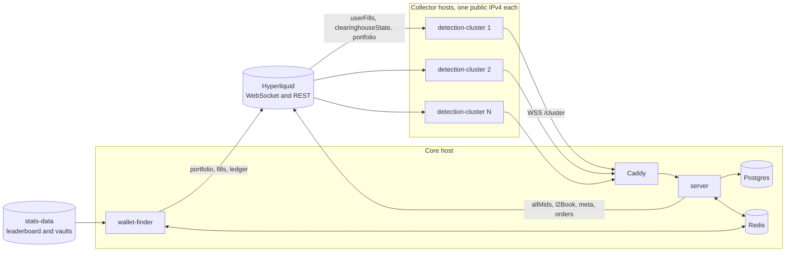

# remora

remora is a copy-trading system for Hyperliquid perpetuals.
It scores the large wallets of the public leaderboard every day, watches the best of them in real time, and copies their trades in paper mode or live.

## Architecture



| Package | What it is |
|---|---|
| `detection-cluster/` | the collector, one per public IP, which streams the fills, positions and equity of at most 8 wallets to the core |
| `server/` | the core: the cluster link, ingestion, signals, the decision engine, paper and live execution, reconciliation, jobs, the API and the replay |
| `wallet-finder/` | the daily discovery and scoring worker, which talks to the server only through BullMQ |
| `dashboard/` | a Vite and React app for leaders, decisions, copies and collectors, fed by the API and a server-sent event stream |
| `sdk/` | the Hyperliquid types, the info client, the socket, the weight budget and the cluster protocol shared by every service |
| `hyperliquid-sim/` | a stand-in for the part of the Hyperliquid API the system uses, which enforces the per-IP limits and knows the true answer to every fill |
| `scale-lab/` | system tests that run the real images against the simulator at scale and through failures |

Hyperliquid limits each IP to 10 users across user-specific subscriptions, 10 sockets and 1,200 REST weight a minute.
The collectors are the only part those limits force onto separate machines.
Each collector runs on its own public IPv4 and holds at most 8 wallets, which leaves headroom under the user limit.
Everything else runs on one core host.
wallet-finder is a separate process, so parsing the large leaderboard file and scoring its wallets never blocks the event loop of the copy path.
The split also gives discovery its own slice of the core's REST budget.

## The path of one copied trade

1. A tracked leader's order fills, and Hyperliquid pushes the fills to the collector that holds the wallet, over one multiplexed `userFills` subscription.
2. The collector forwards the raw frame to the core over its authenticated WebSocket link, together with the time it received it.
3. The core stores each main-dex perp fill once under `(wallet, coin, tid)` and turns the new fills of each coin into a signal, with the leader's position before and after taken from `startPosition`.
4. The signal enters the promise chain of its book, the main book for LIVE leaders and a ledger of its own per SHADOW leader, so no two actions ever touch one copy at once.
5. The decision engine, a pure function that paper, live and replay share, runs 11 policies in a fixed order: instrument, leader mode, episode, exit path, kill switch, signal age, price drift, coin lock, leader equity, sizing and margin.
6. The decision is stored with its 11-line trace before anything is sent.
7. An entry is an IOC limit at the leader's VWAP banded by the drift limit.
   An exit is an IOC limit 3% through the mid, sized against the leader's position with the copy's ratio frozen at open.
8. The paper executor waits 900 ms by default to stand in for the order round trip from Tokyo, then walks the live `l2Book`.
   The live executor signs the order with a client order id and a 5 s expiry, and resolves an unknown result by that id once the expiry has passed.
9. The copy position, its fees and its stop are updated, and the dashboard and Telegram hear about it from one in-process event stream.

Each wallet has a watermark, the time up to which every fill is stored.
After any reconnect the collector backfills from the watermark over REST.
The core holds the wallet's signals until the backfill reports `synced`, then decides the held fills as one catch-up per coin.
The REST history can trail the live stream by seconds.
A backfill reports `synced` only once REST has caught up with the newest fill the collector held back, which closes the gap between them.
A fill that was stored but never decided, because the core crashed in between, joins the wallet's next catch-up.

## Running it locally

You need Node 24.15 or later with corepack, which fetches the pinned pnpm, and Docker with Compose v2.

```sh
corepack enable
pnpm install
pnpm -r run build
```

### The whole system against the simulator

This needs no Hyperliquid access and no internet once the images are built.

```sh
SIM_SPEED=30 docker compose -f docker-compose.yml -f docker-compose.sim.yml --profile app up --build -d
```

Open the dashboard at http://127.0.0.1:8080, or on `DASHBOARD_PORT` when 8080 is taken, and press "Run now" on the overview page.
wallet-finder scores the simulator's 300 synthetic wallets, and selection moves 6 of them into the shadow book.
The collector subscribes them, and paper copies open, resize and close as they trade.
`SIM_SPEED` makes the synthetic wallets trade that many times more often, so copies show up every few minutes.

`docker compose -f docker-compose.yml -f docker-compose.sim.yml -f docker-compose.failover.yml --profile app up -d` adds a second collector and sets both to 4 wallets.
Stopping the first one moves its wallets to the second after a 30 s grace period.

### The whole system against Hyperliquid

```sh
docker compose --profile app up --build -d
```

This runs one copy of every service with one collector of 8 wallets, which is all one home IP can hold.
The local REST budgets are 300 a minute for the collector, 300 for the server and 500 for wallet-finder.
Anything else on the same IP spends from the same limits.
`STAGE_ONE_LIMIT` defaults to 200 locally to shorten a discovery run.
An empty value runs the full stage one, which takes much longer at the production budget of 600.
The root `.env.example` lists the overrides, such as the host ports of Postgres and Redis when 5432 and 6379 are taken.

### Services on the host

```sh
docker compose up -d
cp server/.env.example server/.env
cp detection-cluster/.env.example detection-cluster/.env
pnpm --filter server prisma:migrateDeploy
pnpm --filter server start:dev
pnpm --filter detection-cluster start:dev
REDIS_URL=redis://127.0.0.1:6379 pnpm --filter wallet-finder start:dev
pnpm --filter dashboard dev
```

The example files pair the collector's dev token with the hash the server accepts.
Add a wallet by hand with `curl -X POST 127.0.0.1:3000/api/leaders -H 'content-type: application/json' -d '{"address":"0x..."}'`, and it enters the shadow book at once.
Vite serves the dashboard on http://127.0.0.1:5173 and proxies `/api` to the server.

### Tests

```sh
pnpm -r run lint
pnpm -r run typecheck
pnpm -r run test
pnpm -r run test:integration
```

The integration specs start their own Postgres and Redis through Testcontainers, so they need Docker.
`pnpm --filter scale-lab lab` builds the images from the compose files, then runs every scale-lab scenario.
`pnpm --filter scale-lab lab:baseline` runs the baseline scenario alone.

### Replay

```sh
pnpm --filter server replay --wallet 0x... --days 30
```

The replay reads a leader's last 30 days of fills, candles and funding and runs them through the same decision engine.
It writes `reports/replay-<wallet>-<date>.md` and `.json` under the directory it runs in, with every number labelled as a replay of its window.
It reads the server's configuration, so it runs with `server/.env` in place.
It calls the info endpoint that `HYPERLIQUID_API_URL` names, which can be the simulator.
